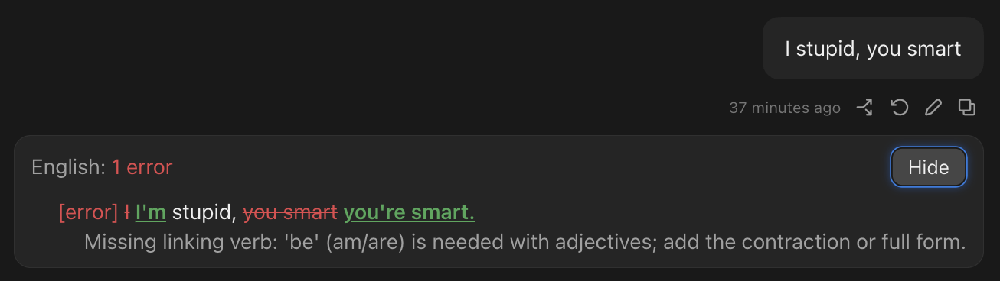
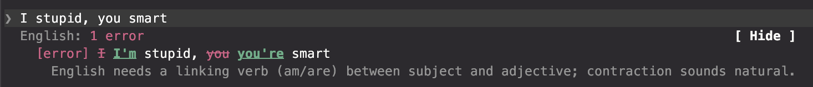

# english-coach

A Claude Code mod for non-native English speakers. Every prompt you send gets a quick grammar check, and the result shows as a small card under your message.

Click **Show** to see each sentence as a word diff. Removed words are red and struck through, and added words are green and underlined.

In the desktop app:



In the terminal:



Issues come in three levels:

| Level | Meaning |
|---|---|
| `error` | Wrong. A native speaker would notice it (articles, tense, prepositions, agreement, spelling). |
| `better` | Correct, but a native speaker would say it differently. |
| `nit` | Optional polish. |

It pays extra attention to articles (a / an / the / none), which are hard to get right if your first language has none.

## Install

At the prompt of a Claude Code session:

```
/plugin install english-coach --marketplace k4ttitude/english-coach
```

Answer `y` to add the marketplace, then pick a scope. From a shell:

```bash
claude plugin install english-coach --marketplace k4ttitude/english-coach
```

## How it works

- After you submit a prompt, the mod sends its prose to Claude Haiku in the background, so your prompt isn't held up.
- It skips slash commands, prompts under 3 words, and anything inside `inline code` or fenced code blocks.
- Feedback for the last 50 prompts stays for the rest of the session.
- In the desktop and mobile apps the card sits on the right under your message. In the terminal and VS Code it sits on the left.

## Cost

Each checked prompt makes one small Haiku call, billed to your own Claude account or API key.

## Files

- `hooks/coach.ts` has the model's instructions, the reply parser and the word diff, all pure functions.
- `hooks/register.tsx` has the two hooks: `prompt.submit` starts the check, and `ui.render` on `UserMessage` draws the card.
- `types/index.d.ts` declares the mod's saved state.

Run the tests with:

```bash
claude plugin test .
```

## License

MIT
